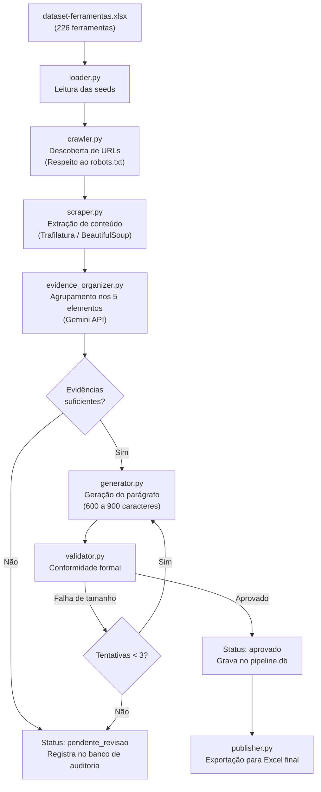

# Pipeline de Extração e Validação do Campo `tool_context`

Pipeline automatizado de coleta, extração textual, estruturação de evidências e geração assistida por IA para o preenchimento do campo `tool_context` das ferramentas cadastradas na base HarmonIA/LumIA, em conformidade com as diretrizes do **Protocolo de Curadoria — Edição dos Dados de Ferramentas**.

---

## 1. Visão Geral

O objetivo deste projeto é processar as 226 ferramentas listadas no arquivo `dataset-ferramentas.xlsx`, pesquisando suas páginas oficiais, documentações técnicas e repositórios para redigir um parágrafo técnico fundamentado em evidências verificáveis.

### Princípios do Pipeline
- **Rastreabilidade estrita**: Nenhuma informação é gerada sem suporte em evidências coletadas de fontes oficiais.
- **Não adulteração de dados existentes**: O único campo atualizado na base é `tool_context`. Os identificadores, nomes, links e demais atributos permanecem intocados.
- **Preservação do dataset original**: A planilha de entrada permanece inalterada; os resultados são consolidados em uma nova planilha (`output/dataset-ferramentas-final.xlsx`).
- **Respeito a diretivas de acesso**: O crawler respeita instruções do `robots.txt`, aplica atrasos configuráveis entre requisições e registra falhas de acesso sem interromper a execução global.

---

## 2. Controle de Versão e Isolamento sem Contêineres

Para garantir reprodutibilidade e isolamento de variáveis e dependências sem recorrer à sobrecarga de contêineres Docker/Podman, este projeto adota a combinação de **`uv`**, **`.python-version`** e **`direnv`**.

### 2.1. Como a Solução Opera

```
┌───────────────────────────────────────────────────────────────┐
│ Diretório do Projeto: webcrawler/                             │
│                                                               │
│  .python-version  ──► Fixa a versão do runtime (ex: 3.12)    │
│  uv / .venv       ──► Isola bibliotecas e binários Python     │
│  .envrc / direnv  ──► Injeta variáveis ao entrar no diretório │
│                       e descarrega tudo ao sair               │
└───────────────────────────────────────────────────────────────┘
```

1. **Fixação da versão do interpretador (`.python-version`)**:
   O arquivo `.python-version` na raiz define a versão exata do Python (`3.12`). O gerenciador `uv` (ou alternativamente `pyenv`) lê esse arquivo e garante que o ambiente virtual use o interpretador correspondente, baixando-o automaticamente caso não esteja instalado no sistema operacional.

2. **Isolamento de dependências (`uv` e `.venv`)**:
   O ambiente virtual `.venv` local contém apenas os pacotes declarados em `pyproject.toml` e travados em `uv.lock`. Nenhuma dependência é instalada no Python global da máquina.

3. **Isolamento de variáveis de ambiente (`direnv` / `.envrc`)**:
   O `direnv` intercepta a navegação no terminal (`cd`). Ao entrar na pasta do projeto, ele ativa o ambiente virtual e exporta as chaves do `.env` localmente na sessão do shell. Ao navegar para qualquer outro diretório, as variáveis e o ambiente virtual são imediatamente descarregados, impedindo vazamento de credenciais e conflito entre projetos.

---

## 3. Instalação e Configuração

### 3.1. Pré-requisitos
- Sistema operacional Linux ou macOS.
- Interpretador Python 3.10 ou superior (ou deixar o `uv` instalar automaticamente).
- Chave de API da Google Gemini.

### 3.2. Passo a Passo

#### 1. Instalar o `uv` (caso ainda não possua)
```bash
curl -LsSf https://astral.sh/uv/install.sh | sh
source $HOME/.local/bin/env
```

#### 2. Configurar o interpretador Python e instalar dependências
Na raiz do projeto, execute:
```bash
# O uv lê o arquivo .python-version e sincroniza as dependências em .venv
uv sync
```

#### 3. Configurar variáveis de ambiente
Crie seu arquivo `.env` a partir do modelo:
```bash
cp .env.example .env
```
Edite o arquivo `.env` informando sua chave:
```env
GEMINI_API_KEY=sua_chave_aqui
GEMINI_MODEL=gemini-2.5-flash
CRAWL_DELAY_SECONDS=2.0
CRAWL_MAX_DEPTH=2
CRAWL_MAX_PAGES_PER_TOOL=10
```

#### 4. (Opcional, mas Recomendado) Ativar isolamento automático com `direnv`
Caso utilize o `direnv` no seu ambiente:
```bash
# Instalação no Debian/Ubuntu (caso não tenha)
sudo apt install direnv

# Configuração no ~/.bashrc ou ~/.zshrc (executar uma única vez)
echo 'eval "$(direnv hook bash)"' >> ~/.bashrc
source ~/.bashrc

# Ativar no projeto
cp .envrc.example .envrc
direnv allow
```

A partir desse momento, ao entrar na pasta do projeto via terminal, o `.venv` será carregado e as variáveis do `.env` estarão disponíveis exclusivamente para essa sessão.

---

## 4. Estrutura do Projeto

```
webcrawler/
├── dataset-ferramentas.xlsx              # Planilha original de entrada
├── Orientacao_Tecnica_Pipeline_tool_context.docx  # Documento de orientação técnica
├── pyproject.toml                        # Metadados e dependências do projeto
├── uv.lock                               # Resolução estrita de dependências
├── .python-version                       # Versão do Python fixada (3.12)
├── .env.example                          # Modelo de variáveis de ambiente
├── .envrc.example                        # Modelo de isolamento via direnv
├── .gitignore                            # Exclusão de artefatos locais
├── historico_de_alteracoes.md            # Registro formal de alterações
├── config.py                             # Centralização de parâmetros e caminhos
├── models.py                             # Dataclasses tipadas e enums de status
├── database.py                           # Camada SQLite de auditoria e controle
├── utils.py                              # Utilitários de rede, URLs e logging
├── loader.py                             # Leitura do dataset Excel
├── crawler.py                            # Web crawler (robots.txt, seeds, depth)
├── scraper.py                            # Extração textual (Trafilatura + BS4)
├── evidence_organizer.py                 # Classificação dos 5 elementos via LLM
├── generator.py                          # Redação do parágrafo único (600–900 chars)
├── validator.py                          # Validação sintática e de restrições
├── publisher.py                          # Geração da planilha Excel de saída
├── main.py                               # Orquestrador executável via CLI
├── data/
│   └── pipeline.db                       # Banco SQLite de auditoria operacional
├── logs/
│   └── pipeline.log                      # Registro cronológico detalhado
└── output/
    └── dataset-ferramentas-final.xlsx    # Planilha final com tool_context
```

---

## 5. Arquitetura do Pipeline



---

## 6. Guia de Uso da Interface de Linha de Comando (CLI)

O script principal `main.py` oferece múltiplos parâmetros de controle de execução:

| Parâmetro | Tipo | Descrição |
|---|---|---|
| `--limit N` | Inteiro | Processa apenas as primeiras `N` ferramentas da planilha. |
| `--tool-id ID` | Inteiro | Executa o pipeline exclusivamente para a ferramenta correspondente ao ID informado. |
| `--dry-run` | Flag | Executa crawling e scraping reais, registrando as evidências no banco sem realizar chamadas pagas ao LLM. |
| `--reprocess` | Flag | Força o reprocessamento de ferramentas que já possuam contexto aprovado no banco de dados. |
| `--publish-only` | Flag | Não realiza coletas; apenas consolida os contextos aprovados no banco em uma nova planilha Excel. |
| `--report` | Flag | Exibe um resumo estatístico do banco de dados (ferramentas processadas, pendentes, falhas) e encerra. |
| `--verbose` | Flag | Habilita logs detalhados em nível `DEBUG` no terminal. |

### Exemplos de Comandos

#### Teste em modo dry-run (sem custo de API)
```bash
uv run python main.py --limit 3 --dry-run --verbose
```

#### Processar uma ferramenta específica por ID
```bash
uv run python main.py --tool-id 1
```

#### Executar um lote controlado de 10 ferramentas
```bash
uv run python main.py --limit 10
```

#### Executar o processamento completo das 226 ferramentas
O pipeline é incremental por padrão: registros já aprovados no SQLite são ignorados automaticamente.
```bash
uv run python main.py
```

#### Consultar o status da base de auditoria
```bash
uv run python main.py --report
```

#### Regenerar a planilha final a partir do banco de dados
```bash
uv run python main.py --publish-only
```

---

## 7. Banco de Dados e Auditoria

Todas as operações de rede e decisões do modelo são persistidas no banco SQLite local `data/pipeline.db`.

### Esquema das Tabelas

1. **`crawl_log`**:
   - `tool_id`: Identificador da ferramenta de origem.
   - `seed_url`: URL cadastrada na planilha.
   - `discovered_url`: URL acessada ou descoberta pelo crawler.
   - `crawl_depth`: Profundidade em relação à seed (0 para seed, 1 ou 2 para links internos).
   - `robots_allowed`: Booleano registrando conformidade com o robots.txt.
   - `http_status`: Código de retorno HTTP (ex: 200, 403, 404).
   - `crawl_status`: Status operacional (`concluido`, `ignorado`, `erro`).

2. **`scrape_evidence`**:
   - `tool_id`: Chave de relacionamento.
   - `source_url`: URL de onde o texto foi extraído.
   - `source_type`: Classificação da fonte (`pagina_oficial`, `documentacao`, `repositorio`, etc.).
   - `page_title`: Título capturado da página.
   - `extracted_text`: Texto limpo preservado para auditoria.
   - `content_hash`: Hash SHA-256 do conteúdo para controle de alterações.
   - `scrape_status`: Status (`concluido`, `parcial`, `falhou`).

3. **`generation_log`**:
   - `tool_id`: Chave de relacionamento.
   - `generated_text`: Texto redigido pelo modelo.
   - `char_count`: Contagem de caracteres (com espaços).
   - `attempt_number`: Número da tentativa de ajuste.
   - `status`: Classificação final (`aprovado`, `pendente_revisao`, `falha_tecnica`).
   - `issues`: Descrição em JSON de inconsistências detectadas.

---

## 8. Critérios de Conformidade de `tool_context`

Todo texto aprovado atende rigorosamente aos seguintes requisitos:
1. **Extensão**: Entre 600 e 900 caracteres, incluindo espaços.
2. **Formatação**: Redigido em um único parágrafo contínuo.
3. **Estrutura dos 5 elementos obrigatórios na ordem**:
   - *1. Funcionamento*: O que a ferramenta faz e como opera.
   - *2. Entrada e saída*: Formatos de dados aceitos e resultados gerados.
   - *3. Tarefas atendidas*: Cenários práticos de aplicação.
   - *4. Requisitos de utilização*: Contas, instalação, chaves de API, dependências técnicas.
   - *5. Diferenciais e limitações*: Características singulares e limitações declaradas em fontes oficiais.
4. **Tom e neutralidade**: Factual e descritivo; ausência de juízos subjetivos de valor, slogans publicitários e alegações de superioridade infundadas.
