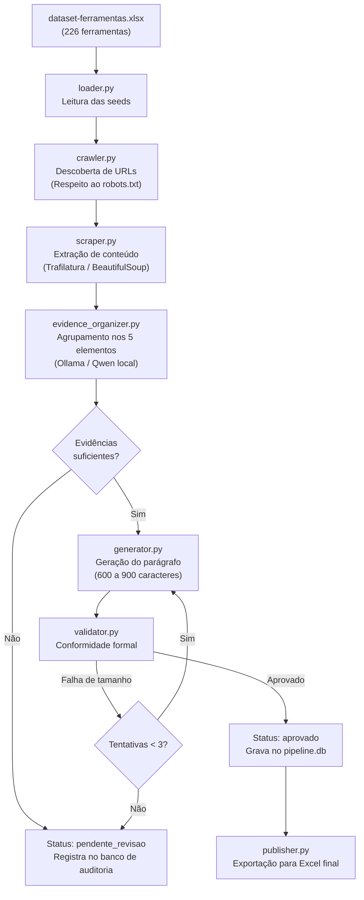

# Pipeline de Extração e Validação do Campo `tool_context`

Pipeline automatizado de coleta, extração textual, estruturação de evidências e geração assistida por IA para o preenchimento do campo `tool_context` das ferramentas cadastradas na base HarmonIA/LumIA, em conformidade com as diretrizes do **Protocolo de Curadoria — Edição dos Dados de Ferramentas**.

---

## 1. Visão Geral

O objetivo deste projeto é processar as 226 ferramentas listadas no arquivo `dataset-ferramentas.xlsx`, pesquisando suas páginas oficiais, documentações técnicas e repositórios para redigir um parágrafo técnico fundamentado em evidências verificáveis.

### Princípios do Pipeline
- **Rastreabilidade estrita**: Nenhuma informação é gerada sem suporte em evidências coletadas de fontes oficiais.
- **Não adulteração de dados existentes**: O único campo atualizado na base é `tool_context`. Os identificadores, nomes, links e demais atributos permanecem intocados.
- **Preservação do dataset original**: A planilha de entrada permanece inalterada; os resultados são consolidados em uma nova planilha (`output/dataset-ferramentas-final.xlsx`).
- **Respeito a diretivas de acesso**: O crawler respeita instruções do `robots.txt`, aplica atrasos configuráveis entre requisições e registra falhas de acesso sem interromper a execução global.
- **Resiliência e Execução Incremental**: Todas as etapas (crawling, scraping e geração) são salvas em tempo real no banco SQLite local (`data/pipeline.db`). Ferramentas aprovadas são ignoradas em novas execuções, permitindo pausar e retomar o processamento a qualquer momento com zero perda de dados.

---

## 2. Isolamento de Ambiente (uv & Poetry)

O projeto é agnóstico ao gerenciador de ambientes virtuais e suporta tanto **uv** (recomendado para máxima performance e inicialização instantânea) quanto **Poetry**.

### 2.1. Como a Solução Opera

```
┌───────────────────────────────────────────────────────────────┐
│ Diretório do Projeto: webcrawler-tool-context/                │
│                                                               │
│  .python-version  ──► Indica o runtime alvo (3.12)            │
│  uv / Poetry      ──► Resolve e instala dependências isoladas │
│  .venv            ──► Ambiente virtual local no projeto       │
│  uv.lock / lock   ──► Registram versões exatas e deterministas│
│  pipeline.db      ──► Auditoria e checkpoints transacionais   │
└───────────────────────────────────────────────────────────────┘
```

1. **Dependências isoladas**: Os pacotes são mantidos em `.venv/` no diretório do projeto, sem afetar o Python do sistema operacional.
2. **Reprodutibilidade**: Bloqueios de versão fixados em `poetry.lock` e `uv.lock`.
3. **Execução rápida com uv**: Usar `uv run --no-sync` permite pular checagens de lockfile na inicialização, rodando diretamente no ambiente existente.
4. **Credenciais seguras**: Chaves e hosts de LLM residem exclusivamente no arquivo local `.env` (não versionado).

---

## 3. Instalação e Configuração

### 3.1. Pré-requisitos
- **Python 3.10+** (Python 3.12 recomendado, conforme `.python-version`).
- **uv** (recomendado) ou **Poetry 2.x**.
- **Ollama** instalado e acessível localmente (para inferência 100% privada e gratuita com Qwen 2.5).

### 3.2. Passo a Passo

#### Opção A: Usando `uv` (Recomendado)
```bash
# Sincronizar o ambiente virtual
uv sync

# Ou executar comandos diretamente
uv run python main.py --report
```

#### Opção B: Usando `Poetry`
```bash
poetry config virtualenvs.in-project true --local
poetry install
```

---

### 3.3. Configuração do Modelo Local (Ollama + Qwen 2.5)

Para executar o pipeline sem envio de dados a provedores externos e sem custo de tokens de API:

1. Baixe o modelo Qwen 2.5 7B (otimizado para placas como RTX 4060 Ti 8GB):
```bash
ollama pull qwen2.5:7b
```

2. Certifique-se de que o Ollama está rodando:
```bash
ollama serve
```

3. Crie ou ajuste o arquivo `.env` na raiz do projeto:
```env
# Provedor LLM: 'ollama' (padrão local) ou 'gemini' (nuvem)
LLM_PROVIDER=ollama

# Configuração Ollama
OLLAMA_HOST=http://localhost:11434
OLLAMA_MODEL=qwen2.5:7b
OLLAMA_TIMEOUT_SECONDS=300

# Configuração Gemini (opcional, caso LLM_PROVIDER=gemini)
GEMINI_API_KEY=
GEMINI_MODEL=gemini-2.5-flash

# Parâmetros do Crawler
CRAWL_DELAY_SECONDS=2.0
CRAWL_MAX_DEPTH=2
CRAWL_MAX_PAGES_PER_TOOL=10
```

---

## 4. Estrutura do Projeto

```
webcrawler-tool-context/
├── dataset-ferramentas.xlsx              # Planilha original de entrada (226 ferramentas)
├── Orientacao_Tecnica_Pipeline_tool_context.docx  # Documento de orientação técnica LumIA
├── pyproject.toml                        # Metadados e dependências do projeto
├── poetry.lock                           # Lockfile do Poetry
├── uv.lock                               # Lockfile do uv
├── poetry.toml                           # Configuração local do Poetry
├── .python-version                       # Versão do interpretador Python (3.12)
├── .env.example                          # Modelo de variáveis de ambiente
├── .envrc.example                        # Modelo de isolamento via direnv
├── .gitignore                            # Exclusão de artefatos transitórios e segredos
├── historico_de_alteracoes.md            # Registro formal de alterações
├── config.py                             # Centralização de configurações e parâmetros
├── models.py                             # Dataclasses tipadas e enums de status
├── database.py                           # Camada SQLite de auditoria e controle transacional
├── utils.py                              # Utilitários de rede, logging e console UTF-8
├── loader.py                             # Leitura do dataset Excel original
├── crawler.py                            # Web crawler (robots.txt, seeds, controle de profundidade)
├── scraper.py                            # Extração textual (Trafilatura + fallback BeautifulSoup)
├── llm_client.py                         # Cliente unificado de LLM (Ollama e Gemini)
├── evidence_organizer.py                 # Classificação das evidências nos 5 elementos obrigatórios
├── generator.py                          # Redação do parágrafo técnico (600–900 chars)
├── validator.py                          # Validação sintática e de restrições do protocolo
├── publisher.py                          # Geração da planilha Excel de saída
├── main.py                               # Orquestrador CLI com modo incremental
├── data/
│   └── pipeline.db                       # Banco SQLite de auditoria operacional
├── logs/
│   └── pipeline.log                      # Registro cronológico detalhado
└── output/
    └── dataset-ferramentas-final.xlsx    # Planilha final gerada com tool_context preenchido
```

---

## 5. Arquitetura do Pipeline



---

## 6. Guia de Uso da Interface de Linha de Comando (CLI)

O script principal `main.py` oferece múltiplos parâmetros para controle granular da execução:

| Parâmetro | Tipo | Descrição |
|---|---|---|
| `--limit N` | Inteiro | Processa apenas as primeiras `N` ferramentas da planilha. |
| `--tool-id ID` | Inteiro | Executa o pipeline exclusivamente para a ferramenta correspondente ao ID informado. |
| `--dry-run` | Flag | Executa crawling e scraping reais, registrando evidências sem chamar o LLM. |
| `--reprocess` | Flag | Força o reprocessamento de ferramentas que já possuam contexto aprovado no banco de dados. |
| `--publish-only` | Flag | Não realiza coletas; apenas consolida os contextos aprovados no banco em uma nova planilha Excel. |
| `--report` | Flag | Exibe um resumo estatístico do banco de dados (ferramentas processadas, pendentes, falhas) e encerra. |
| `--verbose` | Flag | Habilita logs detalhados em nível `DEBUG` no terminal e no arquivo de log. |

### Exemplos de Execução

#### Executar o processamento completo das 226 ferramentas
O pipeline é **incremental**: ferramentas já com status `aprovado` no SQLite são ignoradas automaticamente, retomando exatamente do ponto onde parou.
```bash
# Com uv:
uv run --no-sync python main.py --verbose

# Com Poetry:
poetry run python main.py --verbose
```

#### Teste rápido com lote controlado
```bash
uv run python main.py --limit 3 --verbose
```

#### Processar uma ferramenta específica por ID
```bash
uv run python main.py --tool-id 10
```

#### Teste em modo dry-run (somente crawling/scraping, sem inferência de IA)
```bash
uv run python main.py --limit 5 --dry-run
```

#### Consultar o resumo do progresso e status da base
```bash
uv run python main.py --report
```

#### Gerar a planilha final a partir dos dados já aprovados
```bash
uv run python main.py --publish-only
```

---

## 7. Monitoramento em Tempo Real

Durante execuções de longa duração, você pode acompanhar a extração e a inferência por meio dos logs:

* **No Windows PowerShell**:
  ```powershell
  Get-Content logs\pipeline.log -Wait
  ```

* **No Linux / macOS**:
  ```bash
  tail -f logs/pipeline.log
  ```

---

## 8. Banco de Dados e Auditoria

Todas as operações de rede e decisões do modelo são persistidas no banco SQLite local `data/pipeline.db`.

### Esquema das Tabelas

1. **`crawl_log`**:
   - `tool_id`: Identificador da ferramenta de origem.
   - `seed_url`: URL cadastrada na planilha.
   - `discovered_url`: URL acessada ou descoberta pelo crawler.
   - `crawl_depth`: Profundidade em relação à seed (0 para seed, 1 ou 2 para links internos).
   - `robots_allowed`: Booleano registrando conformidade com o robots.txt.
   - `http_status`: Código de retorno HTTP (ex: 200, 403, 404).
   - `crawl_status`: Status operacional (`concluido`, `ignorado`, `erro`).

2. **`scrape_evidence`**:
   - `tool_id`: Chave de relacionamento.
   - `source_url`: URL de onde o texto foi extraído.
   - `source_type`: Classificação da fonte (`pagina_oficial`, `documentacao`, `repositorio`, etc.).
   - `page_title`: Título capturado da página.
   - `extracted_text`: Texto limpo preservado para auditoria.
   - `content_hash`: Hash SHA-256 do conteúdo para controle de alterações.
   - `scrape_status`: Status (`concluido`, `parcial`, `falhou`).

3. **`generation_log`**:
   - `tool_id`: Chave de relacionamento.
   - `generated_text`: Texto redigido pelo modelo.
   - `char_count`: Contagem de caracteres (com espaços).
   - `attempt_number`: Número da tentativa de ajuste.
   - `status`: Classificação final (`aprovado`, `pendente_revisao`, `falha_tecnica`).
   - `issues`: Descrição em JSON de inconsistências detectadas.

---

## 9. Critérios de Conformidade de `tool_context`

Todo texto aprovado atende rigorosamente aos seguintes requisitos do **Protocolo de Curadoria (HarmonIA/LumIA)**:

1. **Extensão**: Entre 600 e 900 caracteres, incluindo espaços.
2. **Formatação**: Redigido em um único parágrafo contínuo.
3. **Estrutura dos 5 elementos obrigatórios na ordem**:
   - *1. Funcionamento*: O que a ferramenta faz e como opera.
   - *2. Entrada e saída*: Formatos de dados aceitos e resultados gerados.
   - *3. Tarefas atendidas*: Cenários práticos de aplicação.
   - *4. Requisitos de utilização*: Contas, instalação, chaves de API, dependências técnicas.
   - *5. Diferenciais e limitações*: Características singulares e limitações declaradas em fontes oficiais.
4. **Tom e neutralidade**: Factual e descritivo; ausência de juízos subjetivos de valor, slogans publicitários e alegações de superioridade infundadas.
